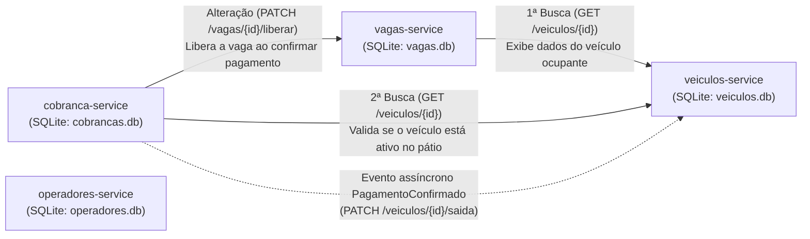

# Sistema de Estacionamento Rotativo

> **Centro Universitário SATC**  
> **Curso:** Engenharia de Software — **Disciplina:** Arquitetura de Software  
> **Professor:** Eduardo Cizeski Meneghel  
> **Avaliação:** Projeto — Arquitetura em Microsserviços (Sistemas Distribuídos)

Sistema distribuído em arquitetura de microsserviços para gestão e controle de pátios de estacionamento rotativo, abrangendo o gerenciamento de vagas, controle de entrada e permanência de veículos, administração de operadores e processamento de cobranças de estadia.

---

## 1. Documento de Requisitos

### 1.1. Propósito do Sistema
O **Sistema de Estacionamento Rotativo** tem como propósito informatizar e descentralizar o controle operacional e financeiro de pátios de estacionamento utilizando uma arquitetura baseada em microsserviços independentes. A solução permite acompanhar em tempo real a disponibilidade de vagas por setor e categoria, registrar o fluxo de entrada e permanência de veículos, gerenciar o quadro de operadores e automatizar o cálculo de tarifas e a liberação imediata de vagas mediante confirmação de pagamento.

### 1.2. Usuários do Sistema
* **Manobrista / Atendente de Pátio:** Responsável pela recepção dos veículos na entrada do estacionamento, cadastro da placa/condutor, verificação de vagas disponíveis e alocação do veículo na vaga correspondente.
* **Operador de Caixa:** Responsável pelo encerramento da estadia, validação da permanência ativa do veículo no pátio, emissão da cobrança proporcional ao tempo utilizado e confirmação do pagamento para liberação da vaga.
* **Administrador / Gestor do Pátio:** Responsável pelo cadastro e manutenção das vagas e setores do estacionamento, gerenciamento dos operadores (turnos, cargos e matrículas) e acompanhamento dos registros operacionais e financeiros.

### 1.3. Requisitos Funcionais (RFs)

| Código | Requisito Funcional | Microsserviço Responsável |
| :--- | :--- | :--- |
| **RF01** | **Gerenciar Vagas:** Permitir cadastrar, listar, consultar por ID, atualizar e excluir vagas do pátio, controlando código identificador (ex.: `A-01`), setor, tipo (`Carro`, `Moto`, `PCD`, `Idoso`), status (`Liberada`, `Ocupada`, `Manutencao`) e o ID do veículo ocupante (`VeiculoId`). | `vagas-service` |
| **RF02** | **Gerenciar Veículos:** Permitir cadastrar, listar, buscar por ID ou placa, atualizar e remover veículos, mantendo placa, modelo, cor, nome e telefone do condutor, data/hora de entrada e status de permanência ativa no pátio (`AtivoNoPatio`). | `veiculos-service` |
| **RF03** | **Gerenciar Operadores:** Permitir cadastrar, listar, consultar por ID, atualizar e excluir operadores do estacionamento, registrando nome, CPF, matrícula, cargo (`Operador de Caixa`, `Manobrista`, `Administrador`), turno e status ativo. | `operadores-service` |
| **RF04** | **Gerenciar Cobranças e Tarifas:** Permitir registrar tickets de cobrança vinculados a um veículo, uma vaga e um operador, calcular o valor total com base no tempo de permanência e tarifa horária, consultar cobranças e registrar a liquidação do pagamento (`Pendente`, `Pago`, `Cancelado`). | `cobranca-service` |
| **RF05** | **Consultar Veículo Ocupante na Busca de Vaga (1ª Busca):** Ao consultar os detalhes de uma vaga específica no `vagas-service`, caso haja um veículo alocado (`VeiculoId`), o serviço deve buscar e retornar automaticamente os dados completos do veículo junto ao `veiculos-service`. | `vagas-service` $\rightarrow$ `veiculos-service` |
| **RF06** | **Validar Veículo Ativo ao Registrar Cobrança (2ª Busca):** Ao registrar uma nova cobrança no `cobranca-service`, o sistema deve consultar o `veiculos-service` para verificar se o veículo existe e se está com entrada ativa no pátio (`AtivoNoPatio = true`) antes de efetivar o registro. | `cobranca-service` $\rightarrow$ `veiculos-service` |
| **RF07** | **Liberar Vaga Automaticamente no Pagamento (Alteração de Dados):** Ao confirmar o pagamento de uma cobrança no `cobranca-service`, o serviço deve disparar uma requisição de atualização para o `vagas-service`, alterando o status da vaga para `Liberada` e limpando o vínculo com o veículo (`VeiculoId = null`). | `cobranca-service` $\rightarrow$ `vagas-service` |
| **RF08** | **Registrar Saída do Veículo de Forma Assíncrona:** Após a confirmação do pagamento, o `cobranca-service` publica um evento que é processado em segundo plano e registra a saída do veículo no `veiculos-service` (`AtivoNoPatio = false`), com novas tentativas automáticas em caso de falha. | `cobranca-service` $\rightarrow$ `veiculos-service` |
| **RF09** | **Sugerir Vaga com Apoio de IA:** Sugerir a melhor vaga livre para o tipo de veículo informado e apresentar uma análise da ocupação do pátio gerada por IA (Claude), com alternativa heurística quando a IA não estiver configurada. | `vagas-service` |

---

## 2. Descritivo Técnico da Arquitetura

### 2.1. Stack Tecnológica e Padrões Adotados
* **Framework / Linguagem:** .NET (ASP.NET Core Web API / C#) seguindo o template de microsserviços da disciplina.
* **Banco de Dados:** SQLite com Entity Framework Core, adotando o padrão *Database per Service* (cada microsserviço possui sua própria base `.db` isolada).
* **Protocolo de Comunicação:** APIs RESTful trafegando JSON sobre HTTP/HTTPS, utilizando `HttpClient` para chamadas síncronas entre microsserviços.
* **Comunicação Assíncrona:** fila de eventos (`System.Threading.Channels`) com *worker* em segundo plano e retentativas no `cobranca-service` (ver seção 6.2).
* **Observabilidade:** health checks, logs estruturados em JSON, Correlation ID propagado entre serviços e endpoint de métricas (ver seção 6.1).
* **Inteligência Artificial:** análise de ocupação do pátio com o Claude (Anthropic) no `vagas-service` (ver seção 6.3).
* **Documentação Interativa:** Swagger / OpenAPI configurado em todos os serviços.
* **Ambiente de Nuvem (PaaS):** Publicação individual dos serviços como *Web Services* na plataforma [Render](https://render.com/).

### 2.2. Microsserviços Existentes e Suas Funções

#### 1. Microsserviço de Vagas (`vagas-service`)
* **Função:** Controlar o inventário físico do pátio de estacionamento, gerenciando a disponibilidade de cada vaga, sua localização por setor, categoria e qual veículo está atualmente estacionado nela.
* **Persistência:** Banco SQLite exclusivo (`vagas.db`) — Entidade `Vaga` (`Id`, `Codigo`, `Setor`, `TipoVaga`, `Status`, `VeiculoId`).
* **Endpoints Principais:**
  * `GET /vagas` — Lista todas as vagas cadastradas e seus respectivos status.
  * `GET /vagas/{id}` — Consulta os detalhes de uma vaga e, se ocupada, integra com o `veiculos-service` para exibir os dados do veículo ocupante.
  * `POST /vagas` — Cadastra uma nova vaga no pátio.
  * `PUT /vagas/{id}` — Atualiza dados cadastrais ou alocação de veículo na vaga.
  * `PATCH /vagas/{id}/liberar` — Atualiza o status da vaga para `Liberada` e remove o vínculo de `VeiculoId` (acionado pelo `cobranca-service`).
  * `DELETE /vagas/{id}` — Remove o cadastro de uma vaga.

#### 2. Microsserviço de Veículos (`veiculos-service`)
* **Função:** Centralizar o cadastro dos veículos e condutores que utilizam o estacionamento, controlando o horário de entrada e o indicador de permanência ativa no pátio.
* **Persistência:** Banco SQLite exclusivo (`veiculos.db`) — Entidade `Veiculo` (`Id`, `Placa`, `Modelo`, `Cor`, `NomeCondutor`, `TelefoneCondutor`, `DataHoraEntrada`, `AtivoNoPatio`).
* **Endpoints Principais:**
  * `GET /veiculos` — Lista todos os veículos registrados.
  * `GET /veiculos/{id}` — Retorna os dados detalhados de um veículo específico (consumido por `vagas-service` e `cobranca-service`).
  * `GET /veiculos/placa/{placa}` — Busca um veículo pela placa.
  * `POST /veiculos` — Registra a entrada/cadastro de um veículo no pátio.
  * `PUT /veiculos/{id}` — Atualiza informações do veículo ou status de permanência (`AtivoNoPatio`).
  * `DELETE /veiculos/{id}` — Remove o registro de um veículo.

#### 3. Microsserviço de Operadores (`operadores-service`)
* **Função:** Gerenciar o cadastro da equipe operacional responsável pelo atendimento no pátio, operação de caixa e administração do estacionamento.
* **Persistência:** Banco SQLite exclusivo (`operadores.db`) — Entidade `Operador` (`Id`, `Nome`, `Cpf`, `Matricula`, `Cargo`, `Turno`, `Ativo`).
* **Endpoints Principais:**
  * `GET /operadores` — Lista todos os operadores cadastrados.
  * `GET /operadores/{id}` — Consulta os dados de um operador por ID.
  * `POST /operadores` — Cadastra um novo operador.
  * `PUT /operadores/{id}` — Atualiza dados cadastrais, turno ou status ativo do operador.
  * `DELETE /operadores/{id}` — Remove um operador.

#### 4. Microsserviço de Cobrança (`cobranca-service`)
* **Função:** Realizar o controle financeiro das estadias, validando o veículo junto ao `veiculos-service`, calculando o valor devido conforme o período de permanência e disparando a liberação automática da vaga no `vagas-service` após a confirmação do pagamento.
* **Persistência:** Banco SQLite exclusivo (`cobrancas.db`) — Entidade `Cobranca` (`Id`, `VeiculoId`, `VagaId`, `OperadorId`, `DataHoraEntrada`, `DataHoraSaida`, `ValorHora`, `ValorTotal`, `FormaPagamento`, `StatusPagamento`).
* **Endpoints Principais:**
  * `GET /cobrancas` — Lista todo o histórico de cobranças e tickets emitidos.
  * `GET /cobrancas/{id}` — Consulta os detalhes de uma cobrança específica.
  * `POST /cobrancas` — Registra uma nova cobrança de estadia após validar no `veiculos-service` se o veículo está ativo no pátio.
  * `PATCH /cobrancas/{id}/pagar` — Confirma o pagamento da estadia e aciona automaticamente o `vagas-service` para liberar a vaga.
  * `DELETE /cobrancas/{id}` — Cancela/remove um registro de cobrança.

---

## 3. Fluxos de Integração entre os Microsserviços



### 3.1. Primeira Busca de Dados — Consulta de Ocupação da Vaga (`vagas-service` $\rightarrow$ `veiculos-service`)
* **Gatilho:** Requisição `GET /vagas/{id}` no `vagas-service`.
* **Comportamento:** Quando a vaga consultada possui um veículo alocado (`VeiculoId != null`), o `vagas-service` realiza uma chamada HTTP `GET /veiculos/{id}` ao `veiculos-service` e agrega no retorno os dados da vaga junto às informações do veículo ocupante (placa, modelo, cor e condutor).

### 3.2. Segunda Busca de Dados — Validação de Cobrança (`cobranca-service` $\rightarrow$ `veiculos-service`)
* **Gatilho:** Requisição `POST /cobrancas` no `cobranca-service`.
* **Comportamento:** Antes de gravar a cobrança no banco de dados, o `cobranca-service` realiza uma chamada HTTP `GET /veiculos/{id}` ao `veiculos-service` para confirmar a existência do cadastro e validar se `AtivoNoPatio == true`. Caso o veículo não exista ou não esteja ativo no pátio, a operação é rejeitada com erro de validação.

### 3.3. Transação de Alteração de Dados — Liquidação e Liberação de Vaga (`cobranca-service` $\rightarrow$ `vagas-service`)
* **Gatilho:** Requisição `PATCH /cobrancas/{id}/pagar` no `cobranca-service`.
* **Comportamento:** Ao confirmar a liquidação do pagamento da estadia (`StatusPagamento = "Pago"`), o `cobranca-service` dispara uma chamada HTTP `PATCH /vagas/{vagaId}/liberar` para o `vagas-service`, que atualiza imediatamente o status da vaga para **`Liberada`** e limpa a referência `VeiculoId`.

---

## 4. Publicação em Nuvem (Render)

Os quatro microsserviços são publicados como **Web Services Docker** no plano **Free** do [Render](https://render.com/), com deploy automático a cada commit na branch `main`.

| Microsserviço | Diretório no Repositório | URL no Render | Documentação (Scalar) |
| :--- | :--- | :--- | :--- |
| **Vagas Service** | `/vagas-service` | https://estacionamento-vagas-service.onrender.com | [`/scalar/v1`](https://estacionamento-vagas-service.onrender.com/scalar/v1) |
| **Veículos Service** | `/veiculos-service` | https://estacionamento-veiculos-service.onrender.com | [`/scalar/v1`](https://estacionamento-veiculos-service.onrender.com/scalar/v1) |
| **Operadores Service** | `/operadores-service` | https://estacionamento-operadores-service.onrender.com | [`/scalar/v1`](https://estacionamento-operadores-service.onrender.com/scalar/v1) |
| **Cobrança Service** | `/cobranca-service` | https://estacionamento-cobranca-service.onrender.com | [`/scalar/v1`](https://estacionamento-cobranca-service.onrender.com/scalar/v1) |

> **Plano Free:** os serviços "dormem" após 15 minutos sem acesso e levam cerca de 1 minuto para acordar na primeira requisição. Por isso, o timeout das chamadas entre microsserviços é de 60 segundos (`Integracoes__TimeoutSegundos`). O SQLite fica no disco efêmero do container: os dados de exemplo (seed) são recriados a cada novo deploy ou reinício.

### 4.1. Como o deploy está configurado
* **`render.yaml` (Blueprint):** descreve os 4 Web Services (runtime Docker, plano Free, `healthCheckPath: /health`, deploy automático e `buildFilter` para que um commit em um serviço só gere novo deploy dele).
* **`Dockerfile` de cada serviço:** build multi-stage com o SDK do .NET 10 e imagem final `aspnet:10.0`. A porta é lida da variável `PORT` que o Render injeta (localmente usa `8080`).
* **URLs de integração por variável de ambiente:** o .NET lê `ServicesUrls__VeiculosService` e `ServicesUrls__VagasService` como `ServicesUrls:VeiculosService` e `ServicesUrls:VagasService` do `appsettings.json`.

| Serviço | Variável de ambiente | Valor no Render |
| :--- | :--- | :--- |
| `vagas-service` | `ServicesUrls__VeiculosService` | `https://estacionamento-veiculos-service.onrender.com` |
| `vagas-service` | `ANTHROPIC_API_KEY` *(opcional)* | chave da API da Anthropic para a análise de ocupação com IA |
| `cobranca-service` | `ServicesUrls__VeiculosService` | `https://estacionamento-veiculos-service.onrender.com` |
| `cobranca-service` | `ServicesUrls__VagasService` | `https://estacionamento-vagas-service.onrender.com` |
| `vagas-service`, `cobranca-service` | `Integracoes__TimeoutSegundos` | `60` |

### 4.2. Passo a passo para publicar
1. No Render, acessar **New > Blueprint** e conectar a conta do GitHub, liberando o repositório `Projeto-Arquitetura-De-Software`.
2. Selecionar o repositório: o Render lê o `render.yaml` e lista os 4 serviços. Confirmar com **Apply**.
3. Aguardar o build dos 4 serviços e conferir se a URL gerada de cada um é igual à da tabela acima. Se o Render adicionar um sufixo ao nome (ex.: `estacionamento-vagas-service-ab12.onrender.com`), atualizar as variáveis `ServicesUrls__*` em **Environment** no serviço que faz a chamada e a tabela deste README.
4. Testar o `GET /health` de cada serviço e depois os fluxos da seção 5.

*Alternativa sem Blueprint:* criar cada serviço em **New > Web Service**, escolher o repositório, **Language: Docker**, **Root Directory** = pasta do serviço (ex.: `vagas-service`), **Instance Type: Free**, **Health Check Path** = `/health`, e cadastrar as variáveis da tabela acima.

---

## 5. Como Testar as Integrações

Os exemplos abaixo usam as URLs do Render. Para testar localmente, troque pelas portas `http://localhost:5001` (vagas), `5002` (veículos), `5003` (operadores) e `5004` (cobrança). Os bancos já começam com dados de exemplo: a vaga `2` (A-02) está ocupada pelo veículo `1`, que tem a cobrança `1` pendente.

```bash
VAGAS=https://estacionamento-vagas-service.onrender.com
COBRANCA=https://estacionamento-cobranca-service.onrender.com

# 1ª Busca: a vaga 2 retorna junto os dados do veículo ocupante (vindos do veiculos-service)
curl $VAGAS/vagas/2

# 2ª Busca: cobrança para o veículo 3 (fora do pátio) é recusada com 409 após consultar o veiculos-service
curl -X POST $COBRANCA/cobrancas -H "Content-Type: application/json" \
     -d '{"veiculoId":3,"vagaId":3,"operadorId":1}'

# Alteração: pagar a cobrança 1 libera automaticamente a vaga 2 no vagas-service
curl -X PATCH $COBRANCA/cobrancas/1/pagar -H "Content-Type: application/json" \
     -d '{"formaPagamento":"Pix"}'
curl $VAGAS/vagas/2   # status "Liberada" e veiculoId null
```

### 5.1. Executar localmente
* **Com Docker:** `docker compose up --build` (portas 5001 a 5004).
* **Sem Docker:** em cada pasta de serviço, executar `dotnet run` (as portas já estão definidas no `launchSettings.json`). A documentação interativa fica em `http://localhost:<porta>/scalar/v1`.

### 5.2. Pacote para entrega
Para gerar o `.zip` com os fontes (sem `bin/`, `obj/` e bancos `.db`), a partir da raiz do repositório:

```bash
git archive --format=zip --output=Projeto-Arquitetura-De-Software.zip HEAD
```

---

## 6. Recursos Extras de Arquitetura (Item 7 da Avaliação)

### 6.1. Observabilidade (todos os microsserviços)
Implementada em `Infra/Observabilidade.cs` de cada serviço, sem dependências externas:
* **Health checks reais — `GET /health`:** usa o `HealthChecks` do ASP.NET Core com uma verificação de conexão ao banco SQLite. Retorna `200 Healthy` ou `503 Unhealthy` e é usado pelo Render (`healthCheckPath`) para saber se o serviço está no ar.
* **Logs estruturados em JSON:** cada requisição gera um log com método, caminho, status e duração em ms, além do nome do serviço e do *Correlation ID* no escopo do log.
* **Rastreamento distribuído por Correlation ID:** o header `X-Correlation-Id` é recebido (ou gerado) na entrada, devolvido na resposta e repassado automaticamente em todas as chamadas `HttpClient` entre os microsserviços (inclusive nos eventos assíncronos). Assim, um único pagamento pode ser seguido nos logs do `cobranca-service`, do `vagas-service` e do `veiculos-service` pelo mesmo ID.
* **Métricas — `GET /metricas`:** total de requisições, erros 4xx/5xx, duração média e máxima, tempo de atividade e contagem por endpoint.

```bash
curl -X PATCH $COBRANCA/cobrancas/1/pagar -H "X-Correlation-Id: demo-pagamento-1"
# depois, procurar "demo-pagamento-1" nos logs dos três serviços no painel do Render
curl $COBRANCA/metricas
```

### 6.2. Comunicação Assíncrona (`cobranca-service`)
Implementada com uma fila de eventos em memória (`System.Threading.Channels`, em `Infra/FilaEventos.cs`) consumida por um *worker* em segundo plano (`BackgroundService`, em `Servicos/ProcessadorEventos.cs`):
* **`PagamentoConfirmado`:** ao confirmar um pagamento, o `cobranca-service` publica o evento e responde na hora; o worker chama `PATCH /veiculos/{id}/saida` no `veiculos-service` para encerrar a permanência do veículo no pátio (`AtivoNoPatio = false`).
* **`LiberacaoVagaPendente`:** se a liberação síncrona da vaga falhar (ex.: `vagas-service` fora do ar ou acordando no Render), o pagamento **não é perdido**: a liberação é reenfileirada e tentada de novo com *backoff* exponencial (2s, 4s, 8s, 16s; até 5 tentativas).
* **Acompanhamento — `GET /cobrancas/eventos?status=`:** lista os últimos eventos com tipo, tentativas, status (`Pendente`, `Processando`, `AguardandoNovaTentativa`, `Concluido`, `Falhou`) e a última mensagem.

> A fila é em memória, adequada ao escopo acadêmico e ao plano Free do Render. Em produção, o mesmo padrão seria aplicado com um *broker* de mensagens (RabbitMQ, Azure Service Bus etc.) para garantir durabilidade.

### 6.3. Integração com IA e Funcionalidade Criativa (`vagas-service`)
* **`GET /vagas/sugestao-ia?tipoVeiculo=Moto`:** sugere a vaga ideal para o próximo veículo. A escolha da vaga é feita por uma regra determinística (tipo compatível, ordem de setor e código) e o **Claude** (IA generativa da Anthropic, via SDK oficial `Anthropic` para .NET) gera uma orientação curta para o atendente, analisando a taxa de ocupação, as vagas livres por tipo e alertas operacionais.
* **Configuração:** basta definir a variável de ambiente `ANTHROPIC_API_KEY` (opcional: `IA__Modelo`; padrão `claude-opus-5-5`). Sem a chave, ou se a IA não responder, o serviço usa automaticamente uma análise heurística local. O campo `fonteAnalise` da resposta informa qual foi usada.
* **Alocação de vaga — `PATCH /vagas/{id}/alocar`:** vincula um veículo a uma vaga livre, completando o ciclo entrada → alocação → cobrança → pagamento → liberação automática.

### 6.4. Endpoints Adicionais

| Serviço | Endpoint | Descrição |
| :--- | :--- | :--- |
| Todos | `GET /health` | Health check com verificação do banco SQLite |
| Todos | `GET /metricas` | Métricas de requisições do serviço |
| Todos | `GET /scalar/v1` | Documentação interativa da API (OpenAPI + Scalar) |
| `vagas-service` | `PATCH /vagas/{id}/alocar` | Aloca um veículo em uma vaga livre |
| `vagas-service` | `GET /vagas/sugestao-ia` | Sugestão de vaga com análise de ocupação por IA |
| `veiculos-service` | `PATCH /veiculos/{id}/entrada` e `/saida` | Registra entrada/saída do veículo no pátio |
| `cobranca-service` | `GET /cobrancas/{id}/calcular` | Simula o valor da estadia até o momento |
| `cobranca-service` | `PATCH /cobrancas/{id}/cancelar` | Cancela uma cobrança pendente |
| `cobranca-service` | `GET /cobrancas/eventos` | Histórico dos eventos assíncronos |

---

## 7. Referências Bibliográficas

As referências seguem o padrão da ABNT (NBR 6023).

### 7.1. Arquitetura de Software e Microsserviços
* EVANS, Eric. **Domain-Driven Design**: tackling complexity in the heart of software. Boston: Addison-Wesley, 2003.
* FIELDING, Roy Thomas. **Architectural styles and the design of network-based software architectures**. 2000. Tese (Doutorado em Information and Computer Science) – University of California, Irvine, 2000. Disponível em: https://ics.uci.edu/~fielding/pubs/dissertation/top.htm. Acesso em: 19 nov. 2026.
* LEWIS, James; FOWLER, Martin. **Microservices**: a definition of this new architectural term. 2014. Disponível em: https://martinfowler.com/articles/microservices.html. Acesso em: 19 nov. 2026.
* NEWMAN, Sam. **Building microservices**: designing fine-grained systems. 2. ed. Sebastopol: O'Reilly Media, 2021.
* RICHARDS, Mark; FORD, Neal. **Fundamentals of software architecture**: an engineering approach. Sebastopol: O'Reilly Media, 2020.
* RICHARDSON, Chris. **Microservices patterns**: with examples in Java. Shelter Island: Manning, 2018.

### 7.2. Integração, Comunicação Assíncrona, Resiliência e Observabilidade
* HOHPE, Gregor; WOOLF, Bobby. **Enterprise integration patterns**: designing, building, and deploying messaging solutions. Boston: Addison-Wesley, 2003.
* KLEPPMANN, Martin. **Designing data-intensive applications**: the big ideas behind reliable, scalable, and maintainable systems. Sebastopol: O'Reilly Media, 2017.
* MAJORS, Charity; FONG-JONES, Liz; MIRANDA, George. **Observability engineering**: achieving production excellence. Sebastopol: O'Reilly Media, 2022.
* NYGARD, Michael T. **Release it!**: design and deploy production-ready software. 2. ed. Raleigh: The Pragmatic Bookshelf, 2018.

### 7.3. Documentação Técnica das Tecnologias Utilizadas
* ANTHROPIC. **Claude API documentation**. Disponível em: https://platform.claude.com/docs. Acesso em: 19 nov. 2026.
* DE LA TORRE, Cesar; WAGNER, Bill; ROUSOS, Mike. **.NET microservices**: architecture for containerized .NET applications. Redmond: Microsoft, 2023. Disponível em: https://learn.microsoft.com/dotnet/architecture/microservices/. Acesso em: 19 nov. 2026.
* MICROSOFT. **Health checks in ASP.NET Core**. Disponível em: https://learn.microsoft.com/aspnet/core/host-and-deploy/health-checks. Acesso em: 19 nov. 2026.
* MICROSOFT. **Entity Framework Core**. Disponível em: https://learn.microsoft.com/ef/core/. Acesso em: 19 nov. 2026.
* MICROSOFT. **System.Threading.Channels library**. Disponível em: https://learn.microsoft.com/dotnet/core/extensions/channels. Acesso em: 19 nov. 2026.
* RENDER. **Blueprint YAML reference**. Disponível em: https://render.com/docs/blueprint-spec. Acesso em: 19 nov. 2026.
* SQLITE. **SQLite documentation**. Disponível em: https://www.sqlite.org/docs.html. Acesso em: 19 nov. 2026.

### 7.4. Material da Disciplina
* CENTRO UNIVERSITÁRIO SATC. **Arquitetura de Software**: template de microsserviço em .NET (SQLite e REST) e especificação do Projeto – Arquitetura em Microsserviços. Criciúma: SATC, 2026. Material didático disponibilizado no portal do aluno.
