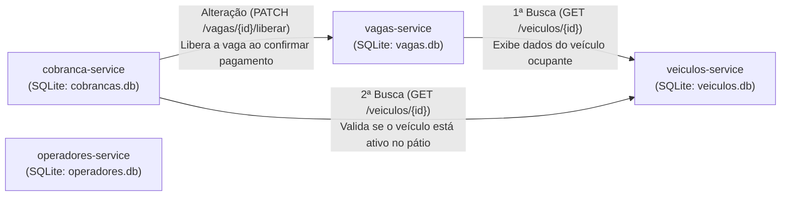

# Sistema de Estacionamento Rotativo

> **Centro Universitário SATC**  
> **Curso:** Engenharia de Software — **Disciplina:** Arquitetura de Software  
> **Professor:** Eduardo Cizeski Meneghel  
> **Avaliação:** Projeto — Arquitetura em Microsserviços (Sistemas Distribuídos)

Sistema distribuído em arquitetura de microsserviços para gestão e controle de pátios de estacionamento rotativo, abrangendo o gerenciamento de vagas, controle de entrada e permanência de veículos, administração de operadores e processamento de cobranças de estadia.

---

## 1. Documento de Requisitos

### 1.1. Propósito do Sistema
O **Sistema de Estacionamento Rotativo** tem como propósito informatizar e descentralizar o controle operacional e financeiro de pátios de estacionamento utilizando uma arquitetura baseada em microsserviços independentes. A solução permite acompanhar em tempo real a disponibilidade de vagas por setor e categoria, registrar o fluxo de entrada e permanência de veículos, gerenciar o quadro de operadores e automatizar o cálculo de tarifas e a liberação imediata de vagas mediante confirmação de pagamento.

### 1.2. Usuários do Sistema
* **Manobrista / Atendente de Pátio:** Responsável pela recepção dos veículos na entrada do estacionamento, cadastro da placa/condutor, verificação de vagas disponíveis e alocação do veículo na vaga correspondente.
* **Operador de Caixa:** Responsável pelo encerramento da estadia, validação da permanência ativa do veículo no pátio, emissão da cobrança proporcional ao tempo utilizado e confirmação do pagamento para liberação da vaga.
* **Administrador / Gestor do Pátio:** Responsável pelo cadastro e manutenção das vagas e setores do estacionamento, gerenciamento dos operadores (turnos, cargos e matrículas) e acompanhamento dos registros operacionais e financeiros.

### 1.3. Requisitos Funcionais (RFs)

| Código | Requisito Funcional | Microsserviço Responsável |
| :--- | :--- | :--- |
| **RF01** | **Gerenciar Vagas:** Permitir cadastrar, listar, consultar por ID, atualizar e excluir vagas do pátio, controlando código identificador (ex.: `A-01`), setor, tipo (`Comum`, `Idoso`, `PCD`, `Moto`), status (`Liberada`, `Ocupada`, `Manutencao`) e o ID do veículo ocupante (`VeiculoId`). | `vagas-service` |
| **RF02** | **Gerenciar Veículos:** Permitir cadastrar, listar, buscar por ID ou placa, atualizar e remover veículos, mantendo placa, modelo, cor, nome e telefone do condutor, data/hora de entrada e status de permanência ativa no pátio (`AtivoNoPatio`). | `veiculos-service` |
| **RF03** | **Gerenciar Operadores:** Permitir cadastrar, listar, consultar por ID, atualizar e excluir operadores do estacionamento, registrando nome, CPF, matrícula, cargo (`Operador de Caixa`, `Manobrista`, `Administrador`), turno e status ativo. | `operadores-service` |
| **RF04** | **Gerenciar Cobranças e Tarifas:** Permitir registrar tickets de cobrança vinculados a um veículo, uma vaga e um operador, calcular o valor total com base no tempo de permanência e tarifa horária, consultar cobranças e registrar a liquidação do pagamento (`Pendente`, `Pago`, `Cancelado`). | `cobranca-service` |
| **RF05** | **Consultar Veículo Ocupante na Busca de Vaga (1ª Busca):** Ao consultar os detalhes de uma vaga específica no `vagas-service`, caso haja um veículo alocado (`VeiculoId`), o serviço deve buscar e retornar automaticamente os dados completos do veículo junto ao `veiculos-service`. | `vagas-service` $\rightarrow$ `veiculos-service` |
| **RF06** | **Validar Veículo Ativo ao Registrar Cobrança (2ª Busca):** Ao registrar uma nova cobrança no `cobranca-service`, o sistema deve consultar o `veiculos-service` para verificar se o veículo existe e se está com entrada ativa no pátio (`AtivoNoPatio = true`) antes de efetivar o registro. | `cobranca-service` $\rightarrow$ `veiculos-service` |
| **RF07** | **Liberar Vaga Automaticamente no Pagamento (Alteração de Dados):** Ao confirmar o pagamento de uma cobrança no `cobranca-service`, o serviço deve disparar uma requisição de atualização para o `vagas-service`, alterando o status da vaga para `Liberada` e limpando o vínculo com o veículo (`VeiculoId = null`). | `cobranca-service` $\rightarrow$ `vagas-service` |

---

## 2. Descritivo Técnico da Arquitetura

### 2.1. Stack Tecnológica e Padrões Adotados
* **Framework / Linguagem:** .NET (ASP.NET Core Web API / C#) seguindo o template de microsserviços da disciplina.
* **Banco de Dados:** SQLite com Entity Framework Core, adotando o padrão *Database per Service* (cada microsserviço possui sua própria base `.db` isolada).
* **Protocolo de Comunicação:** APIs RESTful trafegando JSON sobre HTTP/HTTPS, utilizando `HttpClient` para chamadas síncronas entre microsserviços.
* **Documentação Interativa:** Swagger / OpenAPI configurado em todos os serviços.
* **Ambiente de Nuvem (PaaS):** Publicação individual dos serviços como *Web Services* na plataforma [Render](https://render.com/).

### 2.2. Microsserviços Existentes e Suas Funções

#### 1. Microsserviço de Vagas (`vagas-service`)
* **Função:** Controlar o inventário físico do pátio de estacionamento, gerenciando a disponibilidade de cada vaga, sua localização por setor, categoria e qual veículo está atualmente estacionado nela.
* **Persistência:** Banco SQLite exclusivo (`vagas.db`) — Entidade `Vaga` (`Id`, `Codigo`, `Setor`, `TipoVaga`, `Status`, `VeiculoId`).
* **Endpoints Principais:**
  * `GET /vagas` — Lista todas as vagas cadastradas e seus respectivos status.
  * `GET /vagas/{id}` — Consulta os detalhes de uma vaga e, se ocupada, integra com o `veiculos-service` para exibir os dados do veículo ocupante.
  * `POST /vagas` — Cadastra uma nova vaga no pátio.
  * `PUT /vagas/{id}` — Atualiza dados cadastrais ou alocação de veículo na vaga.
  * `PATCH /vagas/{id}/liberar` — Atualiza o status da vaga para `Liberada` e remove o vínculo de `VeiculoId` (acionado pelo `cobranca-service`).
  * `DELETE /vagas/{id}` — Remove o cadastro de uma vaga.

#### 2. Microsserviço de Veículos (`veiculos-service`)
* **Função:** Centralizar o cadastro dos veículos e condutores que utilizam o estacionamento, controlando o horário de entrada e o indicador de permanência ativa no pátio.
* **Persistência:** Banco SQLite exclusivo (`veiculos.db`) — Entidade `Veiculo` (`Id`, `Placa`, `Modelo`, `Cor`, `NomeCondutor`, `TelefoneCondutor`, `DataHoraEntrada`, `AtivoNoPatio`).
* **Endpoints Principais:**
  * `GET /veiculos` — Lista todos os veículos registrados.
  * `GET /veiculos/{id}` — Retorna os dados detalhados de um veículo específico (consumido por `vagas-service` e `cobranca-service`).
  * `GET /veiculos/placa/{placa}` — Busca um veículo pela placa.
  * `POST /veiculos` — Registra a entrada/cadastro de um veículo no pátio.
  * `PUT /veiculos/{id}` — Atualiza informações do veículo ou status de permanência (`AtivoNoPatio`).
  * `DELETE /veiculos/{id}` — Remove o registro de um veículo.

#### 3. Microsserviço de Operadores (`operadores-service`)
* **Função:** Gerenciar o cadastro da equipe operacional responsável pelo atendimento no pátio, operação de caixa e administração do estacionamento.
* **Persistência:** Banco SQLite exclusivo (`operadores.db`) — Entidade `Operador` (`Id`, `Nome`, `Cpf`, `Matricula`, `Cargo`, `Turno`, `Ativo`).
* **Endpoints Principais:**
  * `GET /operadores` — Lista todos os operadores cadastrados.
  * `GET /operadores/{id}` — Consulta os dados de um operador por ID.
  * `POST /operadores` — Cadastra um novo operador.
  * `PUT /operadores/{id}` — Atualiza dados cadastrais, turno ou status ativo do operador.
  * `DELETE /operadores/{id}` — Remove um operador.

#### 4. Microsserviço de Cobrança (`cobranca-service`)
* **Função:** Realizar o controle financeiro das estadias, validando o veículo junto ao `veiculos-service`, calculando o valor devido conforme o período de permanência e disparando a liberação automática da vaga no `vagas-service` após a confirmação do pagamento.
* **Persistência:** Banco SQLite exclusivo (`cobrancas.db`) — Entidade `Cobranca` (`Id`, `VeiculoId`, `VagaId`, `OperadorId`, `DataHoraEntrada`, `DataHoraSaida`, `ValorHora`, `ValorTotal`, `FormaPagamento`, `StatusPagamento`).
* **Endpoints Principais:**
  * `GET /cobrancas` — Lista todo o histórico de cobranças e tickets emitidos.
  * `GET /cobrancas/{id}` — Consulta os detalhes de uma cobrança específica.
  * `POST /cobrancas` — Registra uma nova cobrança de estadia após validar no `veiculos-service` se o veículo está ativo no pátio.
  * `PATCH /cobrancas/{id}/pagar` — Confirma o pagamento da estadia e aciona automaticamente o `vagas-service` para liberar a vaga.
  * `DELETE /cobrancas/{id}` — Cancela/remove um registro de cobrança.

---

## 3. Fluxos de Integração entre os Microsserviços

### 3.1. Primeira Busca de Dados — Consulta de Ocupação da Vaga (`vagas-service` $\rightarrow$ `veiculos-service`)
* **Gatilho:** Requisição `GET /vagas/{id}` no `vagas-service`.
* **Comportamento:** Quando a vaga consultada possui um veículo alocado (`VeiculoId != null`), o `vagas-service` realiza uma chamada HTTP `GET /veiculos/{id}` ao `veiculos-service` e agrega no retorno os dados da vaga junto às informações do veículo ocupante (placa, modelo, cor e condutor).

### 3.2. Segunda Busca de Dados — Validação de Cobrança (`cobranca-service` $\rightarrow$ `veiculos-service`)
* **Gatilho:** Requisição `POST /cobrancas` no `cobranca-service`.
* **Comportamento:** Antes de gravar a cobrança no banco de dados, o `cobranca-service` realiza uma chamada HTTP `GET /veiculos/{id}` ao `veiculos-service` para confirmar a existência do cadastro e validar se `AtivoNoPatio == true`. Caso o veículo não exista ou não esteja ativo no pátio, a operação é rejeitada com erro de validação.

### 3.3. Transação de Alteração de Dados — Liquidação e Liberação de Vaga (`cobranca-service` $\rightarrow$ `vagas-service`)
* **Gatilho:** Requisição `PATCH /cobrancas/{id}/pagar` no `cobranca-service`.
* **Comportamento:** Ao confirmar a liquidação do pagamento da estadia (`StatusPagamento = "Pago"`), o `cobranca-service` dispara uma chamada HTTP `PATCH /vagas/{vagaId}/liberar` para o `vagas-service`, que atualiza imediatamente o status da vaga para **`Liberada`** e limpa a referência `VeiculoId`.

---

## 4. Publicação em Nuvem (Render)

Os microsserviços da aplicação são configurados para execução pública na plataforma **Render** ([https://render.com/](https://render.com/)):

| Microsserviço | Diretório no Repositório | URL no Render |
| :--- | :--- | :--- |
| **Vagas Service** | `/vagas-service` | *A ser preenchido no deploy (Issue #10)* |
| **Veículos Service** | `/veiculos-service` | *A ser preenchido no deploy (Issue #10)* |
| **Operadores Service** | `/operadores-service` | *A ser preenchido no deploy (Issue #10)* |
| **Cobrança Service** | `/cobranca-service` | *A ser preenchido no deploy (Issue #10)* |